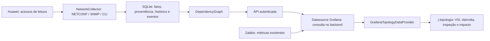

# Arquitetura e evolução incremental

## Base analisada

O JMAP é um plugin frontend React/TypeScript com Grafana data frames, Emotion, editores de opções e um canvas que compartilhava mapa geográfico e topologia. Não possui datasource próprio, coletor de rede ou banco. As opções e posições são salvas no JSON do dashboard pelo Grafana; o histórico recebido vem do datasource existente.

O novo projeto mantém a infraestrutura de build e os módulos `networkTelemetry`, `optionMerge`, `signalHistory`, `opticalModel`, `SignalTrendChart`, `SignalComparison` e ícones vetoriais. O canvas SVG substitui a dependência de Leaflet para este domínio sem coordenadas geográficas. O JMAP não foi editado.

## Componentes

As quatro camadas permanecem distintas: físico, IGP/OSPF, MPLS/TE e serviços/VSI/PW. Uma adjacência OSPF não é automaticamente um cabo físico. A descoberta física aceita LLDP recíproco e interfaces identificadas; VLANIFs e Eth-Trunks sem resolução do underlay não viram cabos presumidos.

Uma VSI é identificada como instância local em um PE, não apenas pelo nome. As consultas de impacto listam essas instâncias; nomes ou VC IDs iguais em redes diferentes não são fundidos como se fossem um cliente global. A correlação do PW de volta exige extremos e VC ID compatíveis sem ambiguidade.

## Regras de evidência

- Um Router ID ou endereço IP precisa corresponder a um único equipamento. Colisões permanecem incompletas.
- Um PW usa um túnel somente com binding ativo observado ou uma out-interface coletada que corresponda a um túnel conhecido. Uma política configurada não é prova.
- O LSP ativo precisa ser informado. Um LSP backup existente não é necessariamente ativo.
- O path real vem dos hops observados; não é calculado a partir do cost OSPF ou do tráfego.
- ERO configurado e lista de segmentos SR não são tratados como RRO completo.
- Ida e volta vêm de PWs/dados independentes. A volta não é a lista de ida invertida.
- Multi-path lista os registros ativos. Percentuais só aparecem com `distributionMeasured=true`.
- A resolução física usa interfaces e enlaces sem ambiguidade. Paralelos precisam ser desambiguados.
- O cost é direcional, com interface/fonte/timestamp próprios; não explica sozinho a decisão TE.
- O custo é coletado por interface mesmo sem vizinho. Endereços /30 recentes e únicos resolvem o P2P lógico; isso não cria um enlace físico. Com mais de uma VLANIF candidata entre dois nós, o next-hop/interface precisa desambiguar o custo contextual do salto.
- A policy específica de um PW prevalece sobre a padrão da VSI. Policy, binding, LSP ativo e saltos têm evidências independentes; uma policy antiga não renova a validade do caminho nem serve para inventar saltos.
- Causa provável e dependência observada não comprovam causalidade nem tráfego efetivo de um serviço.
- Dados stale não confirmam impacto ativo. A proveniência é mantida por campo, evitando renovar o timestamp de um path antigo ao atualizar apenas seu status.

## Persistência

SQLite usa tabelas genéricas tipadas por domínio (`facts`, `observations`) para nodes/devices, interfaces, links, OSPF, tunnels, LSPs, paths/hops, services, PWs e bindings. `events` guarda alterações de path/cost; `discovery_logs` guarda etapas, protocolo, módulos, duração, quantidade e falhas sanitizadas. A retenção padrão é de 30 dias para mudanças/eventos e 7 dias para métricas compactas de interfaces. Inventários e paths inalterados não são duplicados a cada poll; recebem um heartbeat de histórico por hora, enquanto os fatos atuais continuam atualizando sua validade. Índices por entidade/tempo permitem consultas direcionadas. Não há buffer infinito no frontend.

O layout e os overrides pertencem às opções do painel, com merge de três vias para detectar edições concorrentes. O collector nunca escreve no layout do Grafana. O inventário coletado entra automaticamente; cadastro manual é opcional.

## O que precisa da homologação real

1. Registrar a release V200Rxxx/SPC, não somente a linha 5.170.
2. Validar os formatos de CLI e as capabilities NETCONF do S6730 utilizado.
3. Adicionar o mapeamento YANG específico da release para os dados operacionais de VSI/PW/TE/path; o código não adivinha namespaces ou estruturas.
4. Confirmar disponibilidade de RRO/hops. O collector não habilita record-route nem altera a rede.
5. Completar a resolução VLANIF/Eth-Trunk → interface física quando a rede exigir modelos de agregação/bridge específicos.
6. Mapear label/FEC/role nos formatos LFIB de cada release; o parser inicial reconhece o formato SessionID/IngressLsrID/LocalLspID.
7. Validar carga e tempos de resposta com 100 equipamentos. O benchmark de adapter é separado do desempenho de renderização/navegação.

As etapas estão separadas para não transformar ausência de acesso ou de schema em uma alegação falsa de discovery completa.
